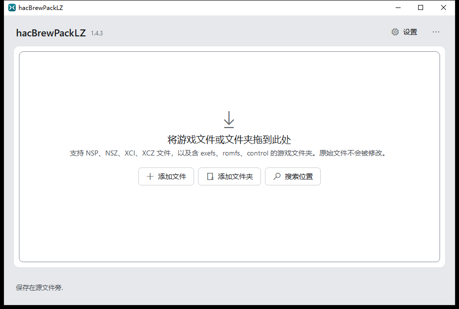
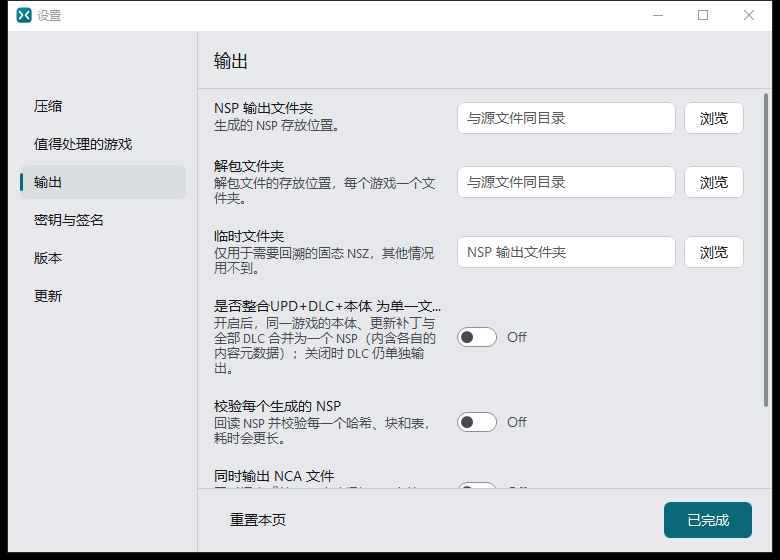
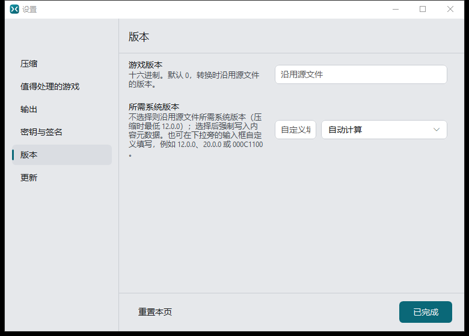
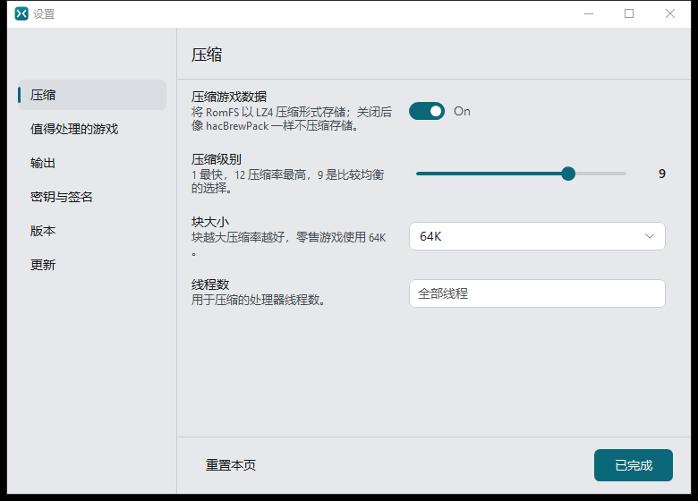
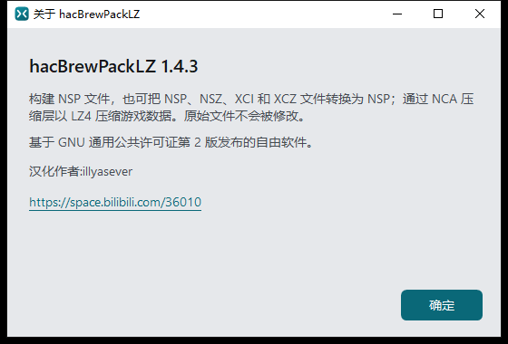

# HacBrewPackLZ 汉化版

> **简体中文界面 · 功能增强 · 免安装 .NET 8 的 Windows 单文件版本**
>
> 上游项目：[hacBrewPackLZ 1.4.3](https://gitlab.com/ismaellozanoperezserrano/hacbrewpacklz)（GNU GPL-2.0）
> 汉化与增强：[illyasever](https://space.bilibili.com/36010)

把 Nintendo Switch 游戏**变小**的工具：把 NSP / NSZ / XCI / XCZ 重建为数据经过 LZ4 压缩的 NSP。
LZ4 是游戏机固件原生支持的 NCA 压缩层，因此压缩后照常运行、无需解包，也不改动任何原始文件。

本仓库是上游 1.4.3 的**简体中文汉化与功能增强版**，包含完整可编译源码、原始上游源码快照（ZIP）、
界面截图与逐版更新日志。上游仓库保持零改动，所有修改均以精确字节补丁方式应用在本仓库源码上。

---

## 界面截图

### 主界面



拖入文件即可开始；支持 NSP、NSZ、XCI、XCZ，以及含 `exefs` / `romfs` / `control` 的游戏文件夹。

### 设置 · 输出



「是否整合 UPD+DLC+本体 为单一文件」是本汉化版新增的合并开关。

### 设置 · 版本



游戏版本（SDK / 密钥世代）与所需系统版本支持下拉选择，也可自定义填入可读版本号或十六进制值。

### 设置 · 压缩



压缩级别、块大小、线程数等原有选项也已完整汉化。

### 关于



关于窗口完整汉化，并附汉化作者与 B 站空间链接。

---

## 软件功能

| 功能 | 说明 |
| --- | --- |
| LZ4 重打包 | 把 NSP / NSZ / XCI / XCZ 重建为 LZ4 压缩的 NSP，主机原生读取，无需解包 |
| 体积预估 | 「分析」逐个列出压缩前 / 后体积与节省百分比，只勾选值得处理的游戏 |
| 合并本体与更新 | 同一 Title ID 的本体 + 更新包（+ DLC）合成同一个文件 |
| 解包 | 把游戏导出为文件夹（`exefs` / `romfs` / `logo` / `control` / `htmldoc` / `legalinfo`） |
| 回读校验 | 生成后回读 NSP 并校验哈希、块表，可用 `--verify` 复核 |
| 发送到 Switch | 通过 Wi-Fi 或 USB 把文件共享给 Switch 端（需配合 NRO） |
| 原文件安全 | 原始文件永不修改，结果另存为 `[LZ4].nsp` |
| 多端可用 | Windows 图形界面 / 命令行 / TUI，以及 Switch 本体运行的 NRO（beta） |

命令行示例：

```bat
hacbrewpacklz analyze -k prod.keys "D:\My Games"
hacbrewpacklz convert -k prod.keys "D:\My Games" --nspdir "D:\Compressed"
hacbrewpacklz extract -k prod.keys "Game.nsp" --outdir "D:\Extracted"
hacbrewpacklz --help
```

`prod.keys` 需自行准备：放在程序同目录，或用 `-k` 指定路径。**仓库与发布包均不包含任何密钥。**

---

## 本汉化版新增功能

汉化覆盖 GUI、CLI、TUI 与运行时提示（约 1200 条词条）。在完整汉化之外，还做了以下功能增强与修复：

1. **本体 + 更新包 + DLC 合并为单一 NSP**
   参照 NSC_BUILDER，放开 `NspWriter` 只预留一个 meta NCA 的限制，按 Application ID 把 DLC 折叠进本体任务，
   一个 NSP 内写入多份 CNMT。开关位于「设置 → 输出」。
2. **DLC 信息进入文件名**
   输出名标注 DLC 数量与版本，例如
   `Pokémon Sword [0100ABF008968000][v458752][v1.3.2][2DLC][LZ4].nsp`。
3. **列表行显示合并摘要**
   存在 DLC 时显示「本体 vX + 更新包 vY + N 个 DLC，重新打包为一个文件」。
4. **SDK / 密钥版本下拉可选**
   可选「沿用源文件」或 `0x3` ~ `0x11` 各代，并同步写入相符的密钥世代；
   **修正了 v4/v5 的 off-by-one 缺陷**（下拉选 `0xD` 却生成 `0xC`）——NCA 头部是 1 起值，
   读取方一律减 1 再查密钥，现已正确写入 `revision + 1`。
5. **所需系统版本下拉 + 自定义填入**
   支持 `12.0.0` / `20.0.0` 等可读版本号或 `000C1100` 十六进制值，并在界面给出范例。
6. **X 按钮清除整个项目**
   点 X 会按 Title ID 从 `TitleSet` 取全部输入一次清理（本体、UPD、DLC、游戏文件夹行），
   不再留下孤立输入导致重读后「复活」。
7. **关于窗口汉化 + 可点击链接**
   加入「汉化作者: illyasever」与 B 站空间链接，并修复构造期 `WM_SIZE` 触发的空引用崩溃。
8. **解包目录名保持英文**
   解包输出 `control` / `data` 等英文目录以与生态工具保持一致，打包时正确读取；
   同时兼容识别旧版本生成的中文「控制」目录。
9. **免安装 .NET 8 的 EXE**
   Windows x64 自包含单文件发布，无需安装任何 .NET 运行时，每个 exe 约 35 MB。

逐版改动明细见 [CHANGELOG.md](CHANGELOG.md) 与 `docs/` 下的原版技术文档。

---

## 免安装运行

发布用的免运行时 EXE 见仓库 **Releases**（`hacbrewpacklz-gui_zh.exe` 图形界面 /
`hacbrewpacklz_zh.exe` 命令行），双击即用，无需安装 .NET 8：

1. 把 `prod.keys` 放在 exe 同目录，或用 `-k` 指定；
2. 拖入游戏文件或文件夹，点「分析」查看预估，再点「压缩」；
3. 输出文件写在源文件旁，文件名以 `[LZ4].nsp` 结尾。

历史 v5 及更早版本是 framework-dependent 构建，需要自行安装 .NET 8，且含上述 SDK 版本缺陷，
**请勿用于正式打包**。

---

## 从源码编译

环境：.NET 8 SDK（见 `global.json`），Windows x64。

```bat
:: 需 .NET 8 运行时的常规构建
dotnet build hacbrewpacklz.csproj -c Release
dotnet build gui/hacbrewpacklz-gui.csproj -c Release

:: 免运行时自包含单文件
dotnet publish hacbrewpacklz.csproj -c Release -r win-x64 --self-contained true ^
  -p:PublishSingleFile=true -p:IncludeNativeLibrariesForSelfExtract=true
dotnet publish gui/hacbrewpacklz-gui.csproj -c Release -r win-x64 --self-contained true ^
  -p:PublishSingleFile=true -p:IncludeNativeLibrariesForSelfExtract=true
```

若构建环境无法访问 NuGet（例如受限沙箱），可离线装配官方
`Microsoft.NETCore.App.Runtime.win-x64` 运行时包后用 `--no-restore` 发布，
完整流程见 `docs/` 与本项目 skill `hacbrewpacklz-zh-release`。
Switch 端 NRO 需要 devkitPro / libnx，编译方式见 `switch/README.md`。

---

## 目录结构

| 路径 | 内容 |
| --- | --- |
| `src/` | C# 核心：NCA / NSP / CNMT / LZ4 / 选项 / 会话 / 校验等（已汉化并增强） |
| `gui/` | Win32 自绘图形界面（含新增 `AboutWindow.cs`） |
| `switch/` | Switch 端 NRO 源码（C++，路径字面量已同步修正） |
| `docs/`、`tests/`、`selftest/`、`tools/`、`assets/` | 上游文档、测试、工具与资源 |
| `screenshots/` | 本汉化版界面截图 |
| `upstream/hacbrewpacklz-upstream-source.zip` | **原始上游源码快照**（打包为 ZIP，已排除 `.git`） |
| `upstream/README-upstream.md` | 上游英文 README 原文 |
| `CHANGELOG.md` | v1 → v7 逐版改动记录 |
| `LICENSE` | GNU GPL-2.0 原文 |

---

## 与上游的关系

- **上游仓库**：<https://gitlab.com/ismaellozanoperezserrano/hacbrewpacklz>，版本 1.4.3，许可证 GPL-2.0。
- 本仓库只做**本地化与功能增强**，不改动上游任何文件；`upstream/` 内的 ZIP 是上游源码原样快照，便于逐行对照。
- 汉化采用「基线副本 + 精确字节补丁」流程：每版一份独立补丁脚本，编译前逐字节重放校验，
  编译后做 `#US` / `#Strings` 堆二进制核验、A-B 行为级反射验证、无运行时实测与 GUI 冒烟。
- 依据 GPL-2.0，本仓库同样以 GPL-2.0 发布，源码一并公开。

---

## 已知限制

- 免运行时 EXE 仅提供 **Windows x64**；Linux / macOS 需按上游方式自行编译。
- Switch 端 NRO 未随汉化迭代重编，仍为上游 v1 构建；Windows 端可兼容识别其解包出的中文目录。
- 开发环境没有 `prod.keys` 与真实 NSP 样本，合并打包、密钥世代写入、输出文件名等仅完成
  编译 / 源码断言 / 反射探针验证，**建议实机打包后运行 `--verify` 复核**。
- 本项目不包含、也不提供任何 Nintendo 密钥或游戏文件。

---

## 致谢

- 上游作者与 [hacBrewPackLZ](https://gitlab.com/ismaellozanoperezserrano/hacbrewpacklz) 项目，GPL-2.0。
- 汉化作者：**illyasever** · <https://space.bilibili.com/36010>
